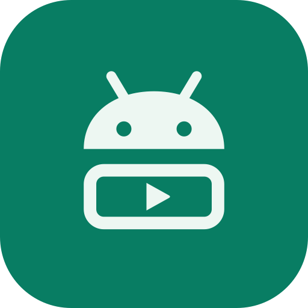
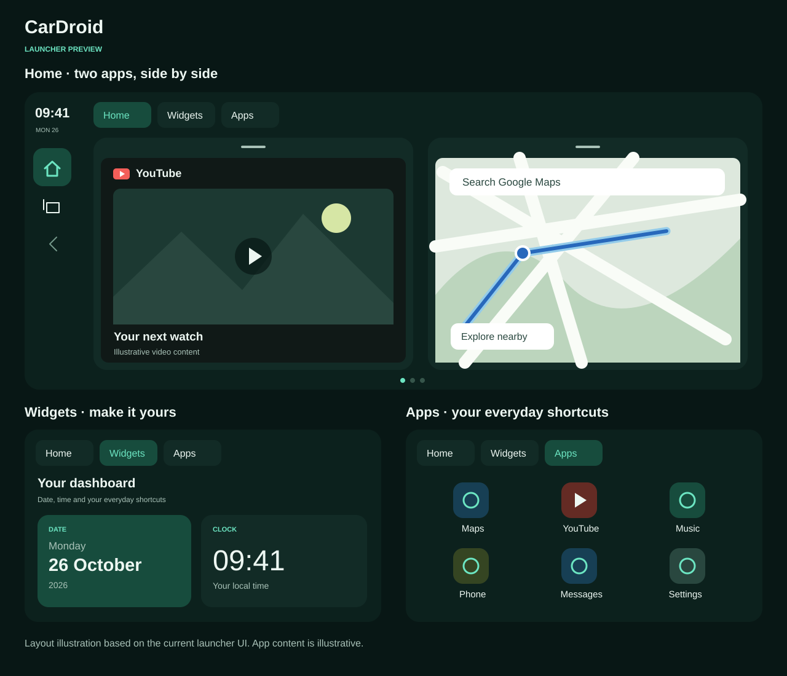

# CarDroid



CarDroid brings an Android launcher to a dedicated car display, with a customizable side-by-side app layout and widget grid. It explores wireless receiver sharing through discovery, pairing, media streaming, and receiver input.

The project is in active development. Device, Android version, receiver, keyboard, and display lifecycle compatibility still need broader validation.

## Launcher preview



*Layout illustration based on the current UI; app content is illustrative. Home keeps two apps side by side, the small indicators open the app picker, and the other pages provide customizable widgets and an app grid.*

## Project

- `app`: Android UI, launcher, device integration, and display helper.
- `libcardroid`: discovery, session, media, and input protocols.
- `mfi-bridge`: authentication interfaces and native integration.
- `tools-runner`: JVM protocol runner and unit tests.
- `tools/car-display-helper.sh`: adb helper lifecycle commands.

The Android package is `com.cardroid.app`. Builds using the earlier package install separately; existing app data does not migrate automatically.

## Build and test

Configure Java 17 and the Android SDK as described in the [build guide](docs/BUILD.md), then run:

```bash
./gradlew :app:assembleDebug :app:testDebugUnitTest :tools-runner:test
```

Install the debug build:

```bash
adb install -r app/build/outputs/apk/debug/app-debug.apk
```

## Documentation

- [Roadmap](docs/ROADMAP.md)
- [Architecture](docs/ARCHITECTURE.md)
- [Protocol notes](docs/PROTOCOL.md)
- [Receiver compatibility](docs/CAR-COMPATIBILITY.md)
- [Capture workflow](docs/CAPTURE.md)
- [Brand assets](docs/brand/README.md)

## Acknowledgments

We learned from public protocol research, receiver implementations, and interoperability experiments. These references informed our understanding of discovery, authentication, media transport, and input handling.

CarPlay, iAP2, and MFi are Apple trademarks. CarDroid is an independent development project and is not affiliated with Apple.
