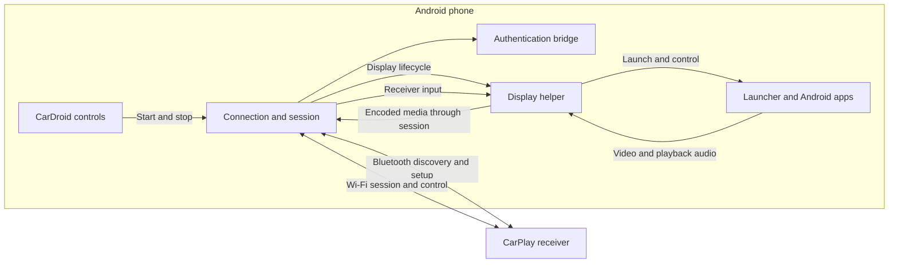

# CarDroid architecture

CarDroid manages the receiver connection on the phone. A display helper runs the launcher and selected Android apps on a separate virtual display, then sends their video and supported playback audio to the receiver. Receiver input is routed back to that display.

The helper starts through Shizuku or adb with shell privileges. If the separate display is unavailable, the app supports a phone-mirroring fallback through Android screen capture.

The connection layer handles discovery, pairing, Wi-Fi handoff, media transport, and receiver commands. The authentication bridge supplies the authentication operations required by that session. Compatibility depends on the phone, Android version, permissions, and receiver.

See the [protocol notes](PROTOCOL.md) for wire details and the [roadmap](ROADMAP.md) for development priorities.
